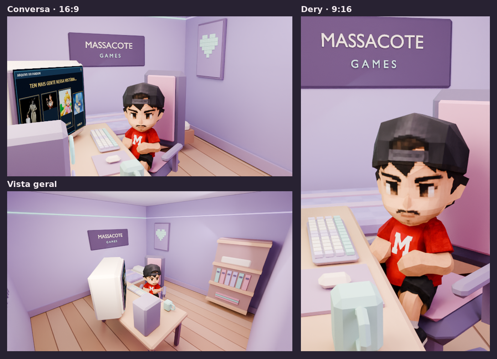

# Quarto chibi do Massacote Games

O quarto da abertura de *Personagens que a internet estragou* recebeu um acabamento em lilás, creme, rosa antigo e menta. A planta, os móveis, os objetos e seus lugares vêm da cena original. A madeira e o reboco são texturas do conjunto House, do [banco 3D](../../biblioteca_psx/README.md).

- [Abrir a prévia em tamanho completo](Quarto_Massacote_Chibi_Previas.png)
- [Comparar com o quarto original](Quarto_Massacote_Chibi_Comparativo.png)
- [Baixar o projeto editável no Blender](Quarto_Massacote_Chibi.blend)

O projeto inclui Dery chibi sentado na cadeira original, rig e seletor `PS1_face_id` com 50 expressões. As câmeras cobrem a conversa em 16:9 e 9:16, o detalhe do CRT e a vista geral. A tela usa um quadro da abertura como exemplo. Para trocar a mídia, abra o material **CRT | mídia da produção**, substitua a imagem no nó **Mídia do CRT** e ajuste a duração do vídeo.

O Blender inclui as texturas e as instruções de uso no texto **LEIA | Quarto Massacote**.
