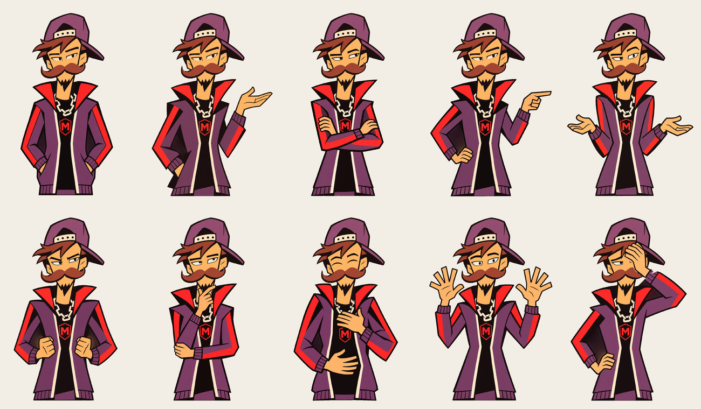

# Massacote Tube — banco modular

10 poses com rosto limpo, 13 opções de olhos/sobrancelhas, bigode independente e mãos em primeiro plano. Arte no visual atual Samurai Jack, cabelo menor e M vermelho. Conjunto e movimento aprovados pelo usuário.

- [Assistir/baixar a prévia com voz](https://github.com/Deriby/Shorts/blob/main/assets/personagens/massacote_tube_2d/modular_01/previa/Previa_Modular_Conversando.mp4?raw=true).
- [Baixar o pacote completo com PNGs, banco e Filmora](https://github.com/Deriby/Shorts/blob/main/assets/personagens/massacote_tube_2d/modular_01/entrega/Massacote_Tube_Modular_01_Completo.zip?raw=true).
- [Instruções de montagem e validação](LEIA-ME.md).
- `galeria.html`: consulta local depois de extrair o pacote.
- `python buscar.py --tipo olhos piscada`: consulta ao banco SQLite.

