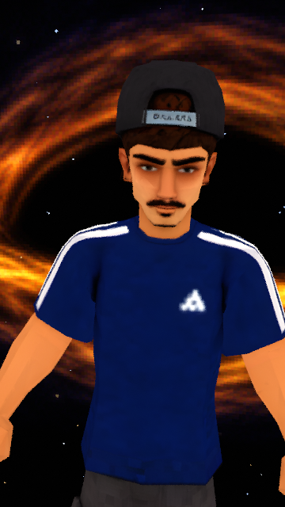

# E se você caísse em um BURACO NEGRO?

**Short 001 · Dery · 3D PS1 / low poly · aproximadamente 1min08s**

## Vídeos

- [Vídeo completo com a voz gravada](production/output/Dery_Buraco_Negro_com_voz.mp4)
- [Vídeo sem áudio para edição](production/output/Dery_Buraco_Negro_sem_voz.mp4)

Entrega vertical 1080 × 1920, sem legendas incorporadas. A voz foi mantida sem alteração de velocidade ou volume. A animação usa o modelo e rig enviados pelo usuário.

## Roteiro e produção

- [Roteiro com a animação cena por cena](roteiro_producao_v4.md)
- [Texto aprovado para narração](roteiro_v3_simples.md)
- [Projeto Blender editável](production/output/Dery_Buraco_Negro.blend)
- [Marcação dos planos na gravação](production/timing.json)
- [Validação do vídeo e áudio](production/output/validacao.json)
- [Instruções para gerar e editar](production/README.md)
- [Expressões PNG e demais ativos](production/assets/)

As versões anteriores do roteiro ficam nesta pasta para consulta. Os quadros intermediários e os estudos descartados são preservados localmente, mas não entram no Git.

Arquivos grandes são armazenados com Git LFS; execute `git lfs pull` depois de clonar.
