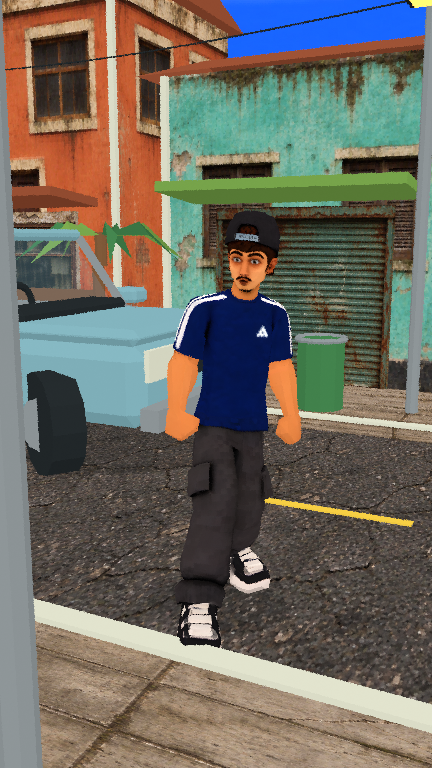

# E se a Terra parasse de girar AGORA?

**Short 002 · Dery · 3D PS1 / low poly · duração-alvo: cerca de um minuto**

Primeira montagem completa: **55,4 segundos, 1080 × 1920, 24 fps**, com 21 planos em cenários 3D de rua, carro, litoral, globo terrestre e órbita do Sol.

## Vídeos e projeto

- [Vídeo completo com voz e efeitos discretos](production/output/Dery_Terra_Parou.mp4)
- [Vídeo sem áudio para edição](production/output/Dery_Terra_Parou_sem_audio.mp4)
- [Projeto Blender editável](production/output/Dery_Terra_Parou.blend)
- [Validação do arquivo e do áudio](production/output/validacao_video.json)
- [Validação da pegada no poste](production/output/validacao_pegada.json)

Mantém o modelo original e a gravação do usuário, sem alterar a velocidade da voz. Sem legendas incorporadas. A pegada do poste foi corrigida com alvos de mão, orientação dos punhos e controle dos cotovelos.

## Roteiro e fontes

- [Texto da narração, versão 1](roteiro_v1.md)
- [Cenas e animação planejadas](animacao_v1.md)
- [Hipótese e fundamentos científicos](notas_cientificas.md)
- [Arquivos e instruções de produção](production/README.md)
- [Modelo Dery compartilhado](../../assets/personagens/dery/)

Manter o personagem, a voz própria, as expressões PNG e a estética retrô do primeiro short. Não incorporar legendas; o usuário fará essa edição.

O roteiro e a primeira decupagem preservam o planejamento; os tempos finais usados na montagem estão em [production/timing.json](production/timing.json).
